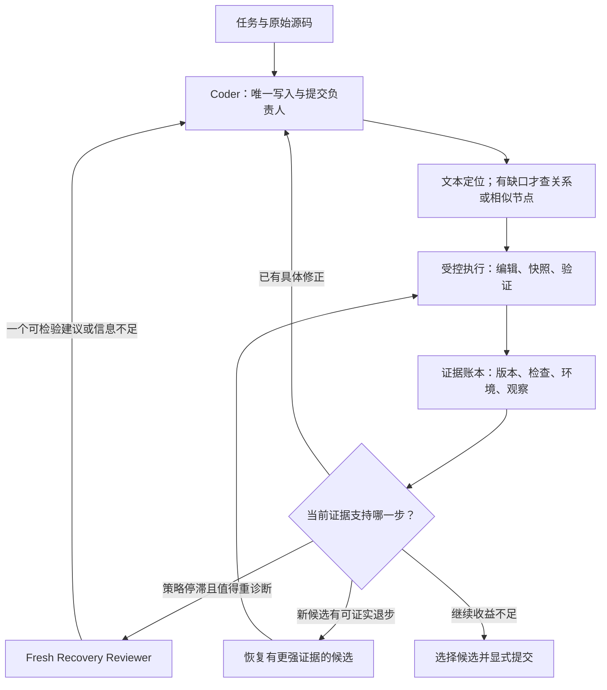

# Gemma 4 31B SWE Agent：恢复架构研究与实验决策

日期：2026-11-08（MYT）  
研究分支：research/dual-agent-recovery-v0-20261108  
研究起点：5eef581fb861eaa779149448857cf81692ece85a  
状态：研究设计；所有新增模型实验均未执行。不是实现完成、候选晋级或性能改善声明。

## 先给结论

**值得首先构建并检验的方向：单写者 Coder＋版本化执行证据＋按需调用的 Recovery Reviewer。**

Coder 负责理解、定位、编辑和最终提交。一个小型、可提交的 Skill 执行层负责记录实际源码变化、关联验证结果和保留候选。只有现有证据出现具体矛盾、当前策略不再产生信息，而且剩余预算能完成修正与复验时，才调用同一个 31B 基座的全新上下文 Reviewer。它提出一个可证伪的诊断或修正建议，不直接写源码，也不决定提交。

这不是“两个模型一定胜过一个”的判断。**第二角色是必须在同预算实验中赚回成本的候选组件；若失败，立即删掉。** 简单 fallback 是已评分、字节固定的 Budget-Fit V2。单角色执行层是实验对照，只有本身带来净收益才保留。

Graph/embedding 仅用于普通搜索无法回答的关系或类比问题，不建设新的向量库。现在不训练；若后续证明正确候选极少出现，优先评估 Coder trajectory SFT＋LoRA。只有正确候选经常出现但决策仍失败，才把学习预算转向选择／恢复策略；RL 排在可靠环境、数据和更便宜训练基线之后。

**最强瓶颈假设是：相关代码和反馈已经存在时，模型仍不能把它们变成正确、真正落盘的修复。** “主要缺验证”“主要丢弃正确补丁”“需要双 agent/RL”均尚未得到当前 thinking-on 31B 的直接证明。

## A. 真实研究状态与反证

### A1. 已核对的事实

| 证据 | 可成立的结论 | 不能据此推出 |
| --- | --- | --- |
| 本账号 58019162：exact Budget-Fit V2，Public 0.17；重新读取既有认证 Actions 日志核对 | 这是当前研究采用的已验证比较基线；来自外部方案的复现 | 不是我们的原创架构改善，也没有单因素归因 |
| 58045795：仅把同一 V2 的上限从 8 分钟改成 5 分钟，Public 0.15 | 一次已有时间上限 screen 的观察结果 | 不证明 8 分钟最优，也不能从一次差值估计稳定提升 |
| canonical submission/ 仍是旧 E4B single-root；31B V2 是外部 ZIP 固定对照 | 必须用评分 ZIP 及其 hash 对齐，不能直接把 submission/ 当作 0.17 | 目录名或 NOW 历史标题不等于实际评分配置 |
| Flexon notebook 标题 v2，Kaggle 版本 V10，公开索引显示 0.22；既有字节审计表明模型、采样和预算与 V2 相同，prompt 不同 | 是有价值的外部单角色 policy comparator | 没有我们自己的 0.22 复现，也没有该 prompt 任何单个行为的因果收益 |
| 本项目 17 条已看过 E4B 轨迹：12 个 unresolved 非空补丁、1 个 reported resolved、4 个空补丁；没有完整中间候选独立评分 | 非空编辑与正确修复有明显区别；历史不足以判断是否丢失过正确候选 | 不能将 E4B 的失败比例投射到当前 31B 或 hidden tasks |
| 外部 31B thinking-off 33 题记录：编辑反馈改良后 exact repeats 14%→10%，resolved 仍为 14/33 | 减少重复、输出更多反馈不自动提高正确率 | 不是 thinking-on V2 的受控消融，也不是“反循环无用”的结论 |
| 同一外部系列的恢复指令 screen：236 次 edit 错误后只有 6 次立即改用 Python，resolved 7/33 vs 9/33 | 追加恢复指令不保证行为发生；调用机会并非独立样本 | 不能据此认定所有恢复方法有害 |
| 另一个作者记录 69 次验证失败尝试中 52 次修改了 reference fix 也修改的文件 | 找到大致文件后仍可能修错 | 文件重叠不等于找对 symbol、根因或完整需求 |
| 既有 verifier LoRA development 1/9→2/9，两个 gain、一个 loss；blind 效果未知 | 旧方法没有被独立验证，也没有被充分证伪 | 不支持现在部署该 adapter，尤其不能迁移为 31B 效果结论 |

认证评分来源：[R1]；本项目证据：[R2–R7]；外部原始记录：[R8–R11]。

0.17 是这里采用的已验证基准值。本轮没有重新查询账号所有最新提交；冻结条目 58081411 的最后已存状态是 2026-11-07 PENDING，**本轮不把该旧状态描述为当前状态，也不假定它已出分。**

### A2. 必须区分的四个瓶颈

1. **执行失败**：意图编辑没有改变源码；包括参数丢失、匹配失败、调用根本没进工具。
2. **生成失败**：生成了可应用补丁，但没有满足完整需求。
3. **选择失败**：曾有独立验证通过的候选，最终却提交了另一个失败候选。
4. **证据／规格不足**：可访问的 issue、源码和测试无法确定隐藏要求，或者验证环境有问题。

它们需要不同干预。不能把“最终验证失败”统一当作应该 rollback 的信号；也不能把“没观察到正确候选”直接当作模型能力不足，除非候选记录完整、评估有效。

领先假设支持生成／反馈使用问题；反证包括严重 malformed calls、部分空补丁，以及缺失的 31B 边界记录。**当前 hidden 失败分布仍未知。**

### A3. 已有三个研究产物各自做到了什么

| 产物 | 已经做到 | 没有做到 | 本设计如何复用 |
| --- | --- | --- | --- |
| paired-check-v0 | Agent 自选 Python 检查；在 original/current 或 current/current 两份源码执行；官方 ADK CPU 适配和打包检查已过 | 未测 31B 会否选到好检查、使用反馈或提高正确率 | 作为一种可选的证据动作，保持原 treatment/control 冻结 |
| candidate-history-v0 | 私评 observer 在工具边界保存不可变补丁；运行结束后独立评分；脚本 CPU controls 区分正确候选保留／被覆盖／未出现／未落盘 | 没有实际 31B 候选可用性结果；真实 Docker 开销未知 | 优先复用作实验仪器；不要把私评 callback 误当可提交功能 |
| frozen base-evidence-retry-v0 | 在 V2 中已有可选、tool-free、fresh-context 31B diagnosis AgentTool；父角色继续写和验证 | 当前没有可用的原始质量提升结论，也不是强制恢复控制器 | 是既有 fresh reasoning comparator，不能改名后宣称双 agent 是新贡献 |

本轮从已有 notebook 中**静态解码并读取**了 frozen ZIP，SHA-256 为 1944471ce98386371ebe52a0d3e6a9cc211ff81803684eeaff5f344532234c1b，未执行 notebook。其 helper 不看当前 patch／仅修改后观测，工具为空，输出上限 768、thinking budget 256。本报告的新问题是：**带版本身份、候选比较和当前矛盾信息的恢复决策，是否比现有 base-only fresh diagnosis 更有效？** 这仍需实验，不是已证创新。

## B. 运行约束与相关系统给出的边界

### B1. 当前官方运行包重新核对

本轮直接查询官方 wheelhouse metadata，返回 currentVersionNumber=31，lastUpdated=2026-10-12T19:51:31.09Z；又按版本 31 重新下载以下三个 wheel，与已有审计缓存逐字节一致：

| 官方包 | SHA-256 |
| --- | --- |
| adk_submission 0.2.13 | f156f0bd84580ccb9334726d114d7a5481f16d3a6e2887cc4d276ced0ef8d99d |
| google_adk 1.36.1 | 1a2f6868c509e3151fb0de3575a7d18b45c338be86f420924dad74e7193631a0 |
| swegemma 0.2.11 | 9ad876581f3acde8ec3c369858f0834e2b9f41a3cffce3ca42f09cb090aea9d3 |

**源码核对结果：**

- ADK compaction 在没有显式 summarizer、root 不是 LlmAgent 时仍会抛出 “No LlmAgent model available for event compaction summarizer.”。所以本设计 root 用 LlmAgent，不用 root SequentialAgent。
- 官方编译器支持 AgentTool、include_contents、Skill 脚本。AgentTool 使用独立 child session，传入 request 和 session state；这不是自动传递整个父对话。
- include_contents:none 的当前实现保留本轮 user input 与本轮工具交互，排除更早的对话；AgentTool 把 request 建成新的 user input。因此可在隔离历史的同时接收本次证据包。session state 仍可能继承，故必须显式约束输入，并在未来 CPU contract check 核对实际模型请求。
- Skill 脚本在 sandbox 内运行；参与者不能把任意宿主 Python controller、私评 observer 或未登记 callback 偷塞进 YAML。schema 支持 callback 名称引用，不意味着允许注册参与者的任意宿主代码。
- run_skill_script 的 args 可用 object 或 array。v0 选择 object 搭配单个字符串 request，避免增加 array 形参数量；这只缩小某类已报告 parser 风险，不能修复全部模型格式错误。
- 上述是公开 v31 包源码事实，不是对私有 scorer 所有运行条件的认证；本轮未跑真实 scorer／模型请求。

官方 wheelhouse：[R12]；工具和预算契约：[R13]。Rules 页直接打开无可读正文；本轮没有声称完成整份比赛法律条款审查。架构相关事实用官方 Overview、Data 索引、staff announcement 与公开官方包交叉核对；未来发布／训练仍须按当时 Rules 和数据许可证检查。

### B2. 总预算不能按“每个 agent 各 8 分钟”理解

官方说明：约 120 个 public/private tasks 共用 12 小时，包含 sandbox setup；每题 max_time_minutes 只计 agent loop，setup 在其外。[R13–R15]

V2 固定对照：

| 参数 | 值 | 如何处理 |
| --- | ---: | --- |
| 基座 | gemma-4-31b-it-qat-w4a16-ct | 所有角色相同 |
| 每题上限 | 8 分钟 | 首批机制比较保留；不当作平均耗时 |
| native tool cap | 28 | 不擅自增加；额外 Skill／ADK 调用也单列记录 |
| turns | 80 | 不是第二角色的免费额外 allowance |
| 单命令 timeout | 240 秒 | 与 8 分钟 session cap 是不同字段 |
| 采样 | T=0.2，top-p=0.95 | 机制比较固定 |
| root output/thinking | 8192 / 4096 | 机制比较固定 |

粗算 720/120=6 分钟／题，尚未扣 setup、server startup 和其他 overhead；120×8=960 分钟只是最坏 cap 总和，不是实际运行时。不能从这条算式断言 V2 一定超时。

可行条件应是：

**server/startup＋所有 setup＋所有 coder/reviewer/tools/compaction/finalization 时间＋保留余量 < 720 分钟。**

Kaggle 可提交界面未证实提供跨任务剩余时间和剩余题数给参与者，故**不设计依赖这个不可见全局状态的在线调度器**。先用完整运行的分布估计整体可行性；单题只根据实际可见剩余预算决策。预算缩短或重分配属于后续独立实验，不能混进角色消融。

### B3. 相关研究：采用机制，不照搬配置

| 一手系统／论文 | 对本问题有用的证据 | 不能照搬的部分 |
| --- | --- | --- |
| SWE-agent | Agent-computer interface 会影响导航、编辑和执行行为 | 改工具接口有可能有益，也可能破坏 31B 已熟悉的工具格式；必须测 |
| Agentless | localization→repair→validation 的简单流程有竞争力；其 patch-selection ablation支持测试筛选价值 | 其多候选和多次测试生成预算不能直接塞进本比赛 |
| MAGIS | 分工协作可以形成可运行的 issue-resolution 系统 | 系统级结果不能证明两个相同 31B 在本预算下胜过一个 |
| SWE-Search | 回溯、候选状态、value/discriminator 与搜索是既有方法；论文还给出 compute-matched 对比 | 有额外搜索开销，其部分 Pass@5 比较仍借助“至少一解”的统计；不复制完整 MCTS＋多人 debate |
| SWE-Gym | 政策训练与 learned verifier 是不同对象；Pass@k 与 Best@k 的差距揭示生成／选择区别 | 不把外部 32B 数据规模和效果直接外推到 Gemma 31B |
| R2E-Gym | execution tests 与 execution-free verifier 有互补性；两者分别受区分力不足与推理／风格偏差影响 | 两票同意不是独立正确性证据，也不是本比赛已验证增益 |
| SWE-RL | 软件工程后训练可产生收益；该工作使用包含 patch similarity 的规则奖励 | 不是“已证明仅靠本地测试 reward 就能学会在线恢复”的证据 |
| Arctic-SWE（2026） | 新近 RL 工作强调 reward integrity、状态一致性、训练／推理对齐、测试强化与 held-out 评估 | Qwen 上的作者报告不等于 Gemma 可复制效果；不能跳过环境和数据成本 |
| SWE-Shepherd（2026） | step-level reward modeling 是可研究方向，并明确存在中间奖励与终局成功不一致问题 | PRM 高分不能替代最终独立 patch grading |

论文来源：[R16–R24]。本报告没有声称这些 broad ideas 是原创；窄贡献是否新颖仍未知。

竞赛内 v19 Analyzer＋Coder 有公开 129-task 记录，但同时改变了工作流、tracing、预算等；单角色 Budget-Fit 也有很强记录。Flexon V10 是更便宜的 policy alternative，而非双 agent 的证据。[R8–R11]

## C. 四种拓扑的独立选择

| 拓扑 | 可能获益的机制 | 主要代价／失败条件 | 决策 |
| --- | --- | --- | --- |
| A：single V2 | 完整连续上下文，无 handoff | 可能固守错误解释或重复无效动作 | 必须保留的评分 control；也是 fallback |
| B：Analyzer→Coder | 提前整理定位与需求，可减少根上下文噪声 | 所有题都支付分析成本；摘要遗漏；已定位题重复劳动；handoff未必成功 | 暂缓，只有定位诊断支持时才开对照 |
| C：Coder＋常规 Critic | 另一推理上下文能发现遗漏／矛盾 | 自我风格偏好、同模型相关错误、每个 patch 都审造成成本膨胀 | 不采用每次编辑必审 |
| D：single writer＋managed evidence＋conditional Recovery Reviewer | 保留真实状态，停止无进展分支；只在可行动矛盾上购买 fresh reasoning | 执行接口改变、Skill adoption和开销；reviewer仍可能无帮助 | 主研究候选；分阶段验证，尚未晋级 |

D 不是永久两个常驻角色。容易题由一个 Coder 完成；复杂题出现特定证据后才请求一个短诊断。Reviewer 必须能输出 INSUFFICIENT，而不是为了审查而编造修改。

## D. 集成架构与完整决策流

这是拟议的数据／控制流，不代表已实现自动状态机。

### D1. 每个组件接收和产生什么

| 组件 | 输入 | 输出 | 权限 |
| --- | --- | --- | --- |
| Coder root LlmAgent | 原 issue、可见源码、证据账本、剩余预算 | 定位动作、具体编辑、检查、恢复／提交决定 | 唯一发起源码变更和 submit_patch 的角色 |
| 受控执行 Skill | 单个结构化 action request、实际 workspace | 执行结果、源码 before/after hash、候选 ID、错误类型 | 只执行明确请求；记录实际变化；不调用模型、不访问 grader |
| 证据账本 | 工具实际结果、源码 manifest、测试与环境身份 | 可复用事实、已否定假设、候选证据偏序 | 保存在 /tmp 等非提交源码位置；不装隐藏答案 |
| Recovery Reviewer AgentTool | 原始 issue、确定的证据包和明确矛盾 | 一项根因／修正建议、一项 preservation obligation，或 INSUFFICIENT | v0 tool-free；无 run_command、edit、write、submit |
| 最终独立 grader | 运行结束后的不可变候选副本和冻结测试 | issue-level correctness 与失败类别 | 私评侧；不把结果喂给运行中的 agent |

Reviewer 同样使用 gemma-4-31b-it-qat-w4a16-ct。初版沿用现有 helper 的小输出配置作为预算边界，不增加第二个模型服务器，也不预设并行。未来可比较 reviewer tools，但本版不让它重新浏览整库。

### D2. 可提交的执行路径与不能做的事情

**主设计的 managed arm：** Coder 保留 read_file、get_status、必要的 graph tools 和 submit_patch；把原生 run_command/edit_file/write_file 从该 arm 的可用工具中移除。源码写入、shell执行及检查统一通过一个官方 Skill script 入口进行，所有支持的操作在执行前后记录实际 workspace，并在异常清理路径保存可恢复候选。脚本自身不调用 LLM。

这使“记录／同状态操作检查／已管理动作的事务恢复”有真实执行位置，而不是一句 prompt。但它明显改变 action interface，**因此必须先有 native-vs-managed 对照；不能把收益归给 Reviewer。** 如果接口让模型更难调用，放弃这个 arm，回到 V2，不再扩建执行框架。

边界同样明确：

- 执行器只能看见成功抵达 Skill 的请求；parser 在工具前丢参或卡死时，它无法拦截。80-turn等 harness 限制仍是最后边界。
- root 是否选择请求 Reviewer 仍由模型控制；编译器不会凭设计图强制调用。测实际 uptake，不能把“建议的策略”称为硬控制。
- 原有 candidate-history callback 只用于私评观察，不放进 submission 冒充宿主扩展。
- Skill 可检查请求结构与执行事实，不能自动证明 shell 的语义正确、测试覆盖充分或候选最优。
- 所有命令、Skill 和 child LLM 时间都计入同一任务及整体预算。28 是原生计数配置，不把额外 ADK工具当作免费计算；真实计数行为在 CPU contract check 和将来日志中逐项核对。
- 本轮只设计这一路径；没有写 dispatcher、增加工具、改候选或修改冻结实验。

### D3. 进展识别：比较状态，不数“重复了几次”

账本为每个观察记录：原始操作与参数、相关文件版本、环境状态、返回结果、被支持／被推翻的假设、实际源码是否变化。不要用未经验证的 shell“语义归一化”把不同命令错误合并。

| 现象 | 判定 | 动作 |
| --- | --- | --- |
| 相同测试在源码变化后重跑 | 新候选需要复验 | 允许；记录新的 candidate/test 配对 |
| 相同搜索但 query／范围／新发现 symbol 不同 | 搜索 frontier 有变化 | 允许，并说明要排除哪个解释 |
| 相同只读动作、相同输入状态、相同结果，且没有待观察的异步变化 | 没有新增事实 | 返回原 receipt，要求换一个有区分力的问题；不能假称新进展 |
| 相同 edit 在相同源码上已证实匹配失败 | 重放不会修正匹配条件 | 返回当前唯一匹配信息，要求重新锚定；不继续执行同一无效 edit |
| 工具报错但源码实际上变化 | 不等于 no-op | 保存实际结果，再诊断；不能机械重复或回退 |
| 工具前格式错误／缺参 | 执行器不可见 | 不作“已阻止”的声明；私评记录为接口故障，必要时放弃该接口设计 |
| 一直定位但没有足以编辑的 contract | 不一定懒于编辑 | 请求能区分实现语义的最便宜证据；不可凭 universal call-10 强行胡乱改 |

**v0硬规则的适用范围：**只对输入能完整确认的受管源码读取（路径／范围／文件内容身份相同）复用旧receipt；只对同一文件内容、同一匹配规则与同一edit参数下已证实失败的edit拒绝重放。任意shell、测试、/tmp、数据库、环境变量或后台状态不满足这种完整可见性，均不做自动缓存／硬拒绝，只返回停滞提示；再次请求时仍实际执行。复用的结果必须注明不是新执行。

重复访问会变化的外部状态或后台过程，必须有显式 poll/refresh理由，并受剩余预算限制；不能将不变源码 hash 当作整个世界不变。

Retry 不是多给一次相同动作：必须改变一个可解释的修复假设、输入证据、编辑锚点或执行方式。没有这种变化且资源即将不足时，结束分支。

### D4. 条件定位：Lexical → 关系／类比 → 停止

1. issue 给出了路径、错误文字、函数名、API参数时，先批量做 rg/git grep，读取小范围实现与一个相关 caller/test。
2. 已有 symbol，但缺少“谁调用／哪里定义／返回值如何传播”的信息时，才用 get_code_neighbors，优先提交从源码核实的 fully-qualified symbol。
3. 已有正确种子 symbol，需要类比 sibling implementation 时，才考虑 search_similar_code。
4. 多个已知 symbol 的连边本身能区分两种修复解释时，才考虑 subgraph。初版不增加 array 形参数调用，等待 parser 当前安全性核对及单独消融。
5. graph absent／node missing／证据与 live source 不一致时，回到文本；不凭空创造节点名反复试。
6. 找到足够明确的编辑 contract 后停止检索；只有新的错误证据推翻它才重新定位。

**重要工具语义：** 当前 search_similar_code 是以现有 symbol 对应的预计算 embedding 查询相似节点，不是任意自然语言 query encoder。neighbors 源码有 exact/suffix/大小写/substring 多层解析，因此“所有 graph API 都必须字节完全一致”也不准确。exact qualified name 最稳妥；模糊匹配须回读确认。

Graph 是 base snapshot 的导航证据，修改后以 live source 为准。静态 AST 对动态调用、缺失节点等存在覆盖限制；旧报告还记录过 async 节点缺失，不能假定当前每个仓库都有完整图。竞赛的 314-call replay 说明工具版本能影响可用性与响应长度，却没有证明 resolved rate 的改善。[R25]

若 lexical 已到正确文件，新增 Graph 只有在提供了**缺失的关系或可区分实现的证据**时才有价值。文件命中率或召回更多节点不构成纳入理由。新增向量模型、重建全库 embeddings 和常驻 RAG server 当前均不选。

### D5. 验证分类与 evidence provenance

每项验证至少绑定：candidate hash、test body／command hash、环境标识、导入源码位置、观察结果和该检查对应的具体需求。

| 结果 | 含义 | 决策后果 |
| --- | --- | --- |
| requirement assertion 在实际候选上失败 | 有效前提下，当前候选没满足这项要求 | 根据反例修复；不自动判旧候选更好 |
| 原先成立且需求未要求改变的行为发生回归 | 当前候选有 preservation contradiction | 比较旧候选同检查结果，必要时 rollback |
| ImportError／collection error／依赖缺失 | 检查未到行为层 | 标记 UNKNOWN／ENVIRONMENT；做廉价环境诊断或换可行检查 |
| 不相关测试失败 | 不能归因于 issue 修复 | 不据此丢弃候选 |
| 自拟检查通过但不能区分 base/current | 可能缺乏区分力 | 不当作“修好”的强证据 |
| base 失败、current 通过且检查有独立需求依据 | 局部行为改善证据 | 仍需 preservation 与独立 issue grading |
| 无输出、skip、跑了错误 checkout、timeout | 没有完整行为证据 | 标记缺失／不确定，保留在实验 denominator |

现有 paired-check 可在 source-copy/import provenance 支持范围内复用；不强制每题都付出双执行成本。已有可信 base observation 时直接复用；源码或环境变化使证据失效时再运行。

Reviewer 产生的测试必须把 assertion 对应回 issue 或可访问的仓库约束。**由另一个 prompt 写出的测试仍可能错误，不是独立 ground truth。** 有冲突时先核对语义，不迎合当前补丁修改 expected output。

### D6. 候选、rollback 与 final selection

候选是对固定 harness baseline 的实际源码差异，包含 staged／unstaged／非忽略新文件及中途 commit 引起的变化。用 manifest/hash 去重，保存到源码树之外；不依赖 HEAD 恰好未动。

恢复前保存当前候选及其未覆盖的证据。只恢复该候选拥有的路径，检查 hash 和目标集合，完成后再核对源码，避免简单 git reset 误删新的有用修改。不向最终 patch 带入账本、临时测试或快照。

选择依据是**可解释的证据偏序**，不是测试数量总分：

- 新候选在同一适用检查和环境下，修复了旧候选的明确失败，且没有新增已证实的保存行为回归：支持采用新候选。
- 新候选破坏了旧候选已确认的行为，又没取得足以支持该改变的新需求证据：支持恢复旧候选。
- 两个候选各有支持、测试不一致或环境不同：不能排出“真正确性”；优先购买一个能区分它们的便宜检查。
- 如果来不及区分：Coder 按需求依据、已知矛盾和最小未经支持的变更作保守选择，显式保留不确定状态。不得声称选出了最优候选。
- 最后一次验证失败本身不触发回退。特别是 partial patch 可能优于 original no-op，只是仍未完成。
- 当前更强证据已经满足可见要求、没有可行动反例，或剩余时间不足以完成下一次编辑＋复验＋提交时，选择已有候选并提交；不为“再想一轮”覆盖它。

最终提交由 Coder 调用 submit_patch；随后不继续改写。仍核对最终 extracted diff／candidate hash。Harness 有 fallback extraction 也不作为正常工作流的替代品。

### D7. Reviewer 何时调用、看什么

调用前要求同时存在：

- 一项具体、与 issue 相关的矛盾或被否定的修复解释；
- 当前策略不能用已有信息给出不同的下一步；不是一次 test fail 就自动加人；
- 可提供足够证据，包括原始 issue、base 相关源码、当前实际 diff／源码身份、检查的原始观察与来源；
- 剩余预算能够承担 reviewer＋应用建议＋复验＋finalization。用将来实测延迟和风险余量估计，不预先把“两分钟／六次”当普适常数。

输入**不带 Coder 的长篇自我辩护和隐藏 reference**。保留原始任务、已验证事实、已试且失败的具体动作，以及可能被 issue 明确改变的 legacy behavior。当前 diff 可以给 reviewer；与 base-only frozen helper 的差异必须单独比较。

输出一个可被下一次观察推翻的建议，而非“再多测试”“换个方法”。Coder 检查建议的依据，再决定应用、换检查、恢复或停止。v0 每题最多一次短 reviewer 调用只是成本受控实验边界，不是宣称所有任务只需一次的科学规律。tool-free helper 降低 runaway 浏览风险；其总调用开销仍要计量。

### D8. 证据如何跨 retry 保留

可复用：文件／symbol定位及版本、明确需求、实际执行的观察、失败的 edit 锚点、已否定的假设、候选与检查身份。

需失效／重验：依赖已改文件的测试结果、旧行号、不同环境的 import结果、当前补丁上的观察，以及被新需求推翻的 legacy constraints。

fresh context 不等于从零漫游，也不等于把整条旧轨迹再灌一次。传递一个短的 factual handoff，原始 receipts 可按身份查回；没有证据的结论不能随着摘要变成事实。

## E. 五项能力的取舍

| 能力 | 选择 | 边际价值与相互作用 | 当前最大风险／删除条件 |
| --- | --- | --- | --- |
| A：progress／loop prevention | 纳入实验候选；仅硬管能看见的执行事实 | 为失败 edit 与候选变更建立真实反馈；为恢复提供状态 | 如接口失败更多、成本增加且没有 resolved gain，退回原接口；保留私评仪器即可 |
| B：Graph／embedding localization | 保留官方工具的条件使用；暂缓新增检索系统 | 定位关系缺口；可为 reviewer 提供反证 | 无新增有效信息、已定位题无收益或拖慢完结时不启用 |
| C：dual-agent | 仅纳入按需、tool-free recovery role 的受控试验 | 检验 fresh interpretation 是否优于同预算 Coder继续 | uptake低、相关错误、handoff耗时或正确率无净增时首先删除 |
| D：verify／repair／selection | 纳入最小候选保留与适用性分类 | 不让失败验证误触发 rollback；把生成与选择分开测 | 无可靠区分证据时不作自动真值判断；不建设复杂投票选择器 |
| E：LoRA／RL | 重新开放，当前暂缓 | 由生成／选择诊断决定训练对象 | 没有干净数据、可靠reward和持出收益前不投入训练 |

## F. 训练决策：现在不训，学习路线保持开放

SFT／preference learning／RL 是训练目标或方法；LoRA／QLoRA 是参数与内存实现方式，不能把它们当成四个互斥选项。

| 将来观察到的限制 | 先做的便宜对照 | 最值得考虑的学习方向 | 重新开放的证据门槛 |
| --- | --- | --- | --- |
| malformed 调用占主要损失 | 当前接口正确性、参数表示与 tool-format alignment | 针对正确工具格式和有效恢复的 trajectory SFT＋LoRA | 原生／受控接口都不能可靠修复，且有跨 repo 的干净正反轨迹 |
| 已定位但正确候选很少出现 | fresh attempt vs 同预算继续；必要信息是否真的到模型 | Coder trajectory distillation／SFT＋LoRA | 完整候选诊断显示生成受限，数据与兼容训练方案可行 |
| 正确候选常出现却未选到 | 证据偏序与单纯停止／保留策略 | 选择／恢复 preference learning、outcome verifier | 同状态候选的独立标签可靠；learned policy 有机会超过简单控制 |
| 决策收益依赖长程探索、短视规则稳定失败 | branch continuation 的 counterfactual 数据 | 小范围 controller RL，再考虑全轨迹 RL | 有可信环境、数据、reward与负样本；SFT／preference 对照留下明确缺口 |
| 执行错误已很低、生成与选择都不足 | 重新判断状态／任务表示与训练数据 | 可能同时适配 Coder 与 Controller | 不同时开两个 adapter；先证明哪一个必要，再做增量 |

**如果最终必须训练，当前证据更支持先考虑 Coder 的有效修复轨迹，而不是直接恢复旧 verifier-only adapter。** 这只是条件优先级，尚无足够依据现在训练任何一侧。

训练数据应来自许可清楚、跨仓库的执行轨迹。按 repository、issue lineage、commit／patch相似度和时间划分，防止同类重复任务穿越 train/validation。保留适用的失败与成功恢复，不把所有非零 test exit 当坏行为屏蔽；只根据可靠标签处理真正格式／执行错误。Teacher licence、轨迹可用性和工具分布必须核对。[R23–R24,R27]

训练 controller 不能只用“最后成功所以之前每一步都正确”的标签。应从同一可见状态分叉 continue／repair／revert／stop，给相同剩余预算，用结束后的独立检查比较结果。若没有这些 counterfactual，承认 credit assignment 不足。

奖励以完整 required behavior＋preservation＋执行完整性为终局信号；中间信号只提供辅助，不能按“测试通过数量／diff变大／少用token”发主要奖励。测试更改、跳过测试、错误checkout、history读取答案、网络取答案、硬编码样例等不能获得成功标签。训练用 grader 对 agent不可见；生产时也不依赖它。

SWE-RL 的 patch similarity reward 与真正行为正确性不同；SWE-Gym/R2E-Gym 的 verifier 思路和 Arctic-SWE 的 reward integrity 是更贴近本问题的设计提醒，不是 Gemma 的现成训练成绩。

31B QAT 推理可运行不等于长轨迹训练能在同一内存预算轻松完成。需核对兼容训练基座、量化与导出、PEFT key/shape、context/template、reasoning与tool parser，以及适配器在官方 serving 中确实改变 logits。后者是有效加载检查，仍不是质量证据。

完整成本包括数据收集／过滤、环境构建、teacher 或 on-policy rollout、每次独立执行评分、优化和持出评价。没有实测吞吐、有效任务数量及预期回收收益前，不报一个虚假的训练小时数。**不启动 RL 的限制状态为 ACTIVE；pivot trigger 是可靠持出证据显示存在便宜控制无法解决、且训练可识别的策略限制。**

## G. 最小可信实验路线：全部未执行

### G1. 共用评估契约

先用当前候选历史仪器回答生成／选择问题；复用现有资产，不再新造一个 benchmark framework。

- 冻结配置、源码 hash、官方 wheel hashes、任务选择算法、seed策略和分析规则后才运行。
- 按曝光登记选择任务，排除已读reference／已调参的开发题。现有已冻结 reserve 不借给新实验，也不假称其旧 gold/no-op gate 已全部通过。
- 优先从比赛公开训练库覆盖 Rich、FastAPI、Requests、HTTPX 四仓库。若独立合格量不够，报告实际覆盖，使用新来源的持出任务；不静默把 inspected cases 叫 blind。
- 模型运行前，由独立评估侧验证 original负控／reference正控与测试执行。对必要的 feature change，使用该任务真实评分契约；无法形成有效对照的题提前标注不可评分。不得看模型结果后换题。
- run failures、missing check、no-op、timeout、未触发 Reviewer 的题都保留在主 denominator；失效任务和漏记录另外报告。任务环境失效造成的未解在全流程 resolved/N 中计未解，同时给出预先定义的有效评估切片，避免把系统失败隐藏掉。
- agent 不接触 reference patch、独立 grader结果或只在评估侧可见的测试清单。新检查须在查看候选评估结果之前冻结／溯源；不能围绕失败补测直到通过。
- 相同模型、采样、task cap、call cap、turn cap、环境与任务顺序分配；顺序应交错或随机区组，记录共享server干扰。
- 相同 cap 不等于实际 compute完全相同。报告总input/output/thinking tokens、LLM次数、compaction、工具时间、setup、CPU验证时间；不把多花的实际计算藏起来。

**Primary：** final resolved/N，使用运行结束后的冻结独立 required tests＋preservation grading。这里的“独立正确”指通过该评估契约，仍不等于形式化证明所有输入都正确。

**Secondary：** correct candidates ever observed、correct candidate retention、empty patch、真实落盘edit、repeat/no-progress、可行动feedback的uptake、相关修复成功率、完成题数、总时间和每个resolved的总成本。

对完整历史，定义 availability=曾出现独立通过候选的题数/N；final=最终通过题数/N；availability−final 是**观测到的候选选择损失上界**。它不是可部署 oracle，也不是独立采样 Pass@k。历史缺失／检查无效时 availability 未知，不记为零。候选越多越易覆盖测试的问题需单列，不能通过多花计算制造“选择器进步”。

### G2. 逐级路线

下表是有停止分支的路线，不是承诺全部执行。8 题 pilot 和 16 题 confirmation 是资源受限的筛选规模；远不足以凭一个小差值声称普遍有效。

| 实验 | 假设与因果机制 | Baseline / treatment；控制变量 | 分母与所需证据 | 判定与停止 |
| --- | --- | --- | --- | --- |
| E0：兼容与观测门 | instrumentation不改变 agent 看到的事实；Skill/AgentTool 输入输出满足官方契约 | 原 V2 vs 私评 observer；另用 scripted responses核对拟议接口，禁止把这当质量结果 | 人工fixture只测接口；覆盖成功／失败edit、异常中已写文件、快照还原、child request、shared budget | 输入变样、漏patch、未计开销、恢复不一致则不进入质量实验 |
| E1：生成／选择诊断 | 现有 V2 的失败可分为未落盘／未生成正确候选／丢候选 | 只观察 exact V2，不改prompt或工具；candidate grader仅事后使用 | 建议首批8题、每仓库2题；保留所有8题；完整可评分候选历史与最终required checks | 若正确候选很少，控制器不能声称解决生成；若频繁丢候选再优先选择；历史不完整只得UNKNOWN |
| E2：执行层bundle screen | 新接口＋记录＋进展策略这整个组合是否值得，暂不归因单组件 | native V2 vs managed单角色；同基座/采样/8min/28/80；不加Reviewer/新检索 | 同一预锁pilot；观察接口uptake、工具前失败、真实源码变化和独立final | resolved不增且开销更大就停；若只有repeat下降，不算性能成功；正screen后才做下述null消融 |
| E3：fresh context与role特化 | fresh reasoning和恢复角色各自是否带来净价值 | 共同checkpoint三臂：现有Coder等预算自审／fresh普通Coder建议／fresh Recovery Reviewer；后两臂相同证据包、tool-free、输出额度和父Coder恢复流程，只改变角色指令 | checkpoint前锁任务；未出现可用checkpoint仍留在端到端分母；至少四仓库；记录原始后续动作和最终独立评分 | Reviewer必须胜过fresh普通Coder才支持role特化；两种fresh都只胜过自审则支持context reset；如果无法可靠fork，不作严格checkpoint因果声明 |
| E4：验证信息 vs 修复能力 | paired observation能否让相同agent做出更好的keep/repair/revert选择 | 复用 paired-check：base/current vs current/current，agent先选同一检查再分叉；环境和剩余预算匹配 | 预锁任务全体，检查不适用也留分母；分别报coverage、有信息时决策改变与final | 有信息但correctness无收益，停止加反馈；信息很少则机制覆盖不足 |
| E5：generation vs selection | 在同一候选池上，选择策略能利用真实可见证据 | 固定candidate pool，比较last candidate／证据偏序／Reviewer建议；独立grader只作事后标签 | 不重新生成池来迎合selector；全题与多候选切片同时报告 | availability低就不训selector；gap大但可见证据无法区分则先改验证，不制造oracle selector |
| E6：检索信息 vs overhead | Graph只在关系缺口上提供超出lexical的有效信息 | 同checkpoint与预算，lexical补充 vs targeted graph；若有正screen再加等长度无关信息control | 新锁题；预定义关系缺口切片及全部任务；记录新证据是否进入下游patch | 文件命中提升但final不升／耗时更高则停；已经定位题无效便保持关闭 |
| E7：deterministic vs learned恢复 | 简单规则剩余错误是可学习的决策限制 | 相同输入、候选、可行动作与预算；固定规则 vs SFT／preference policy；RL只能在前者留下缺口后 | 新的跨repo train/validation/confirmation；同状态fork标签；代码与数据去重 | held-out final无益、仅reward变高或成本更高则停止学习路线，不扫超参数 |

**E2的条件null消融：**只有整个managed bundle初筛有益，才运行预先冻结的同接口／同snapshot开销对照：一臂关闭重复阻止与基于证据的候选恢复，另一臂开启它们。该比较回答progress／recovery policy是否提供超出接口与记录的作用；若需进一步拆分二者，应另开单因素实验，当前不同时归因。没有该null结果，E2只报告bundle收益。

E3 若初筛支持，再按已经预注册的证据包对照 **existing frozen base-only diagnosis vs current-evidence Reviewer**；两者必须同上下文额度与剩余预算。这一步区分“fresh call本身”与“新证据／候选信息”的作用，不能把整个组合收益归给角色数量。

初版 Reviewer 的一次调用是实验上限；实际token与延迟不一致时以观测成本报告，并画／列相同预算下的outcome，不宣称严格相同 FLOPs。需要 padding的因果对照只用于小型研究，不作为部署方案。

### G3. 资源账与 promotion gate

最短主路径是 E0→E1→E2；只有它留下可恢复矛盾，才做 E3。E4 已有研究合同，不因为这份新设计就修改或重复运行；E6/E7 是条件分支。

一个**未来**资源上限例子：pilot的8题×3个完整arm×8分钟=192 active agent-minutes；确认的16题×2个arm×8分钟=256分钟。合计448分钟仅是 active cap上界，**不含setup、server、评估及其他开销**，也不等于Kaggle quota扣时；L4x4扣时倍率须按当时规则另算。不需要同时启动这整套arm，且confirmation只比较已冻结候选与control。

确认集至少四仓库、每仓库四题；如要声称跨仓库转移，再在两个未用于开发的仓库锁额外任务。比赛公开四仓库上的正结果仍不保证hidden私有仓库有效。

**晋级标准提前冻结：**

1. pilot 只决定 stop／是否值得花一次独立confirmation；不给它统计显著性包装。
2. confirmation报告 paired gains/losses、按仓库结果、置信区间和实际总成本。资源筛选可设“16题至少净增2题、覆盖至少2仓库、无整体完成率下降”为预注册的继续研究门槛，**这不是显著性或普遍优越的证明**。
3. 小样本区间若仍跨零，结论写“值得继续／尚不确定”，不能写已证提升。若要强效果声明，事先按所需最小收益和可用资源确定更大样本；不能看到结果后反复加样直到显著。
4. 候选新增时间必须进入12小时可行性投影；用实测任务／setup分布和风险余量评估，不能用平均值或单次成功保证整个run。
5. 若同预算正确率不改善，即使repeats、compliance、测试数更漂亮也不晋级。

**以后才可能的 Kaggle submission gate：** 兼容性、候选冻结、独立评价、整体时间可行性、当前规则与账号队列全部满足后，单次官方screen；读取确切ref及终局结果。Public score只能是嘈杂聚合观察，不能诊断哪一题修好，也不能据一次0.01–0.02变化不停改prompt。当前指令禁止新提交，本轮不触发此gate。

如果以后仍限定“只允许官方submit、不允许任何带task-level记录的模型评价”，就只能做聚合screen；**无法同时满足生成／选择分离、严格角色消融和独立机制结论。** 这种资源选择的证据上限必须说明，不用CPU包装伪装研究验证。

## H. 对推荐架构的九个反对问题

| 问题 | 独立判断与可证伪回答 |
| --- | --- |
| 1. 同计算量，为什么两角色可能胜过一个31B？ | 唯一有说服力的机制是fresh context打破错误解释，且证据包仍保留必要事实。不是多一票。若同预算自审／fresh普通Coder同样好，角色特化没有价值。 |
| 2. Handoff会不会更贵？ | 会。构造证据、重新prefill、摘要、child输出和root继续都耗时。tool-free短回复只减风险，不保证便宜；测所有成本。 |
| 3. lexical已到文件，Graph还有用吗？ | 只有缺失caller／dependency／sibling证据可改变修复解释时有用。否则删掉。 |
| 4. 正确patch从未生成怎么办？ | 快照／selector不能创造答案。先区分信息不足与生成能力；比较fresh repair generation；若可学限制成立，转Coder SFT。 |
| 5. 测试缺失或误导怎么办？ | 记录不确定；从issue与仓库约束找独立支持；不用自拟测试给自己盖章。要求本身不可恢复时，承认验证上限。 |
| 6. 什么时候rollback比再修好？ | 同检查、同环境下新候选有明确回归，且旧候选保留更强证据，而剩余资源不足以安全修复。仅有一个非零退出不足。 |
| 7. RL如何避免记任务？ | 按repo／lineage／时间隔离；同状态counterfactual；不可见独立reward；检测history/network/test hacking；看跨repo final改善，训练reward曲线不算。 |
| 8. 不提升先删谁？ | 先删Reviewer。Graph新增能力已默认关闭；若执行Skill本身导致接口退化或无净收益，再退回native V2。候选observer可只留在私评侧。 |
| 9. 第一个集成实验失败后改什么？ | 不同时再加Graph和RL。execution失败→接口；availability低→生成／信息表示；availability高但final低→选择／验证；local正而held-out负→分布与过拟合；用失败类别选择一次架构pivot。 |

## I. 最终建议与可推翻条件

**选择 D 作为唯一主研究设计，fallback 保持 exact V2；先验证 managed单角色执行层，再购买一次有条件的fresh recovery。**

比 V2 更值得检验的点是：将编辑意图、实际源码、检查和候选身份连接起来，让恢复建立在可追溯状态上；同时把第二角色从每题固定开销改成一个可拒绝、可测收益的动作。它有针对已有失败现象的机制，但并未证明31B效果。

本轮不做“Graph＋双agent＋RL全装”的框架。先解决“下一步为什么可能改变结果，以及这次证据对应哪个实际候选”，再决定是否需要学习。

会推翻此推荐的结果包括：接口更难用；候选和验证记录真实到位但resolved不增；fresh Reviewer不胜过同预算自审／普通重试；额外成本使整体完成率下降；独立仓库收益消失。发生任一情况，撤销对应组件，而不是叠更多prompt维持复杂设计。

### 研究检查点

| 项目 | 当前结论 |
| --- | --- |
| CURRENT BEST | 已核对的研究control：exact 31B V2，Public 0.17；账号其他最新结果本轮未刷新 |
| REAL EVIDENCE OF STRENGTH | 本账号认证历史评分＋固定ZIP；不是CPU检查 |
| MAIN FAILURE MODE | 当前31B未知；外部证据支持编辑落盘／语义生成／反馈使用的竞争解释 |
| CURRENT BOTTLENECK HYPOTHESIS | 现有信息未转成正确、落盘、保留的修复；暂将生成／执行放在纯检索之前 |
| LOCAL BUG OR MODEL-CLASS LIMITATION | 尚不可识别；不能先宣布需要RL |
| EXCLUDED / DEFERRED | 常驻双agent、全量新RAG、MCTS、多adapter一起训、立即RL |
| WHY | 缺当前31B因果证据；预算／接口／数据成本高 |
| PIVOT TRIGGER | 独立诊断明确隔离相应限制，并超过廉价同预算对照 |
| NEXT DISCRIMINATING EXPERIMENT | E1使用现有candidate-history观测exact V2；随后E2只测受控执行 |
| ARCHITECTURE PIVOT | 按availability／final gap、执行错误及迁移结果决定接口、生成训练或选择学习 |

## J. 本轮执行与未执行范围

已完成：读取当前研究分支和现有产物；静态读取评分对照、冻结helper及canonical目录；读取既有认证评分日志；检索并核对一手论文和竞赛讨论；刷新官方wheelhouse metadata并重下三个包；检查ADK／编译器／graph工具源码；形成此研究设计。

未执行：任何神经模型推理、GPU／TPU、训练、真实agent任务评价、候选patch评分、新Kaggle提交、候选晋级、新执行器实现。没有改变canonical submission/、frozen candidates、现有实验分母或盲集合同。

本报告的所有新正确率、延迟、GPU消耗和Kaggle效果均未知。

## 参考来源与复核入口

- **R1 评分记录**：[0.17认证日志](https://github.com/kolihhan/gemma-4-kaggle/actions/runs/42160680339/job/127705338356)；[0.17／0.15认证日志](https://github.com/kolihhan/gemma-4-kaggle/actions/runs/42171026894/job/128018297926)。本轮重新读取旧日志，不是新的Kaggle运行。
- **R2 研究起点**：[NOW@5eef581](https://github.com/kolihhan/gemma-4-kaggle/blob/5eef581fb861eaa779149448857cf81692ece85a/NOW.md)；[Doctrine](https://github.com/kolihhan/gemma-4-kaggle/blob/5eef581fb861eaa779149448857cf81692ece85a/RESEARCH_DOCTRINE.md)。
- **R3 Candidate history**：[README](https://github.com/kolihhan/gemma-4-kaggle/blob/5eef581fb861eaa779149448857cf81692ece85a/experiments/candidate-history-v0/README.md)。
- **R4 Paired check**：[README](https://github.com/kolihhan/gemma-4-kaggle/blob/5eef581fb861eaa779149448857cf81692ece85a/experiments/paired-check-v0/README.md)。
- **R5 语义修复审计**：[report](https://github.com/kolihhan/gemma-4-kaggle/blob/5eef581fb861eaa779149448857cf81692ece85a/docs/research/semantic-repair-gap-audit-2026-11-06.md)。
- **R6 Flexon对照审计**：[report](https://github.com/kolihhan/gemma-4-kaggle/blob/5eef581fb861eaa779149448857cf81692ece85a/docs/research/flexon-budget-policy-review-2026-11-07.md)。
- **R7 V2来源与hash**：[source-pinning code](https://github.com/kolihhan/gemma-4-kaggle/blob/5eef581fb861eaa779149448857cf81692ece85a/scripts/prepare_public_budgetfit_v2.py)；V2 ZIP SHA-256 a4b10f6b8034fd7fffa144a7ee3fbd8faf9a84503ffb1349d1522ba048b534d3。
- **R8 外部31B编辑反馈记录**：[pinned v6.0 notes](https://github.com/happyc0der/gemma-swe-agent/blob/88cfbc6dc9fdce17f90117e17c2ff8c365c7eb16/experiments/2026-10-20-faithful-v60-AB/notes.md)。
- **R9 外部恢复指令负screen**：[pinned notes](https://github.com/happyc0der/gemma-swe-agent/blob/88cfbc6dc9fdce17f90117e17c2ff8c365c7eb16/experiments/2026-10-24-faithful-bf-editfb-off-AB/notes.md)。
- **R10 作者原始研究记录**：[Measuring an Agent While Its Evaluator Moved](https://pilkwangkim.github.io/posts/Gemma-4-Developer-Agent-Part-2-Measuring-an-Agent-While-Its-Evaluator-Moved/)；[v19／129-task原始讨论](https://www.kaggle.com/competitions/gemma-4-developer-agent/discussion/747696)。
- **R11 Flexon V10**：[public notebook/version](https://www.kaggle.com/code/flexonafft/gemma-4-budget-aware-coding-agent-v2/input?scriptVersionId=357955943)。
- **R12 官方wheelhouse**：[dataset](https://www.kaggle.com/datasets/metric/gemma-4-developer-agent-wheelhouse)；[current metadata API](https://www.kaggle.com/api/v1/datasets/view/metric/gemma-4-developer-agent-wheelhouse)。三个包的当前内容hash在B1表。
- **R13 官方约束与工具**：[Overview](https://www.kaggle.com/competitions/gemma-4-developer-agent/overview)；[Data](https://www.kaggle.com/competitions/gemma-4-developer-agent/data)；[本项目bundled HARNESS_README](https://github.com/kolihhan/gemma-4-kaggle/blob/5eef581fb861eaa779149448857cf81692ece85a/HARNESS_README.md)。
- **R14 官方model announcement**：[same variant / different adapters](https://www.kaggle.com/competitions/gemma-4-developer-agent/discussion/748287)。
- **R15 官方任务总预算讨论**：[60 or 120 tasks](https://www.kaggle.com/competitions/gemma-4-developer-agent/discussion/746008)。
- **R16 SWE-agent**：[primary paper](https://arxiv.org/abs/2405.15793)。
- **R17 Agentless**：[primary paper](https://arxiv.org/html/2407.01489v2)，特别是3.3与5.2.3。
- **R18 MAGIS**：[primary paper](https://arxiv.org/abs/2403.17927)。
- **R19 SWE-Search**：[primary paper](https://arxiv.org/html/2410.20285v6)，特别是Appendix I/J。
- **R20 SWE-Gym**：[primary paper](https://arxiv.org/html/2412.21139v2)，特别是5.1的Pass@k／Best@k。
- **R21 R2E-Gym**：[primary paper](https://arxiv.org/html/2504.07164v1)，特别是4.2/4.3。
- **R22 SWE-RL**：[primary paper](https://arxiv.org/abs/2502.18449)。
- **R23 Arctic-SWE**：[2026 primary paper](https://arxiv.org/html/2610.24914v1)，特别是reward integrity与Appendix G/H。
- **R24 SWE-Shepherd**：[2026 primary paper](https://arxiv.org/abs/2604.10493)。
- **R25 Graph工具replay**：[314-call community primary report](https://www.kaggle.com/competitions/gemma-4-developer-agent/discussion/748323)。作为可用性／成本证据，不是解题收益证据。
- **R26 Parser风险报告**：[array argument hang](https://www.kaggle.com/competitions/gemma-4-developer-agent/discussion/753973)。已核对报告；本轮未重现该vLLM错误，也未认证私有scorer是否已修补。
- **R27 训练与serving对齐工具**：[gemma4-swe-kit README](https://github.com/damsolanke/gemma4-swe-kit)。作者的工程可行性记录，不是本项目性能证明。

